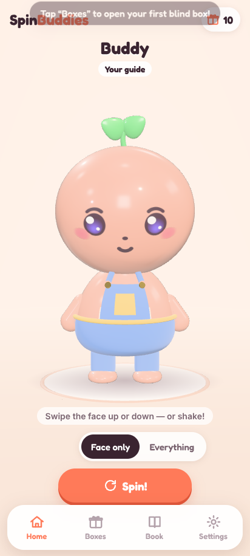
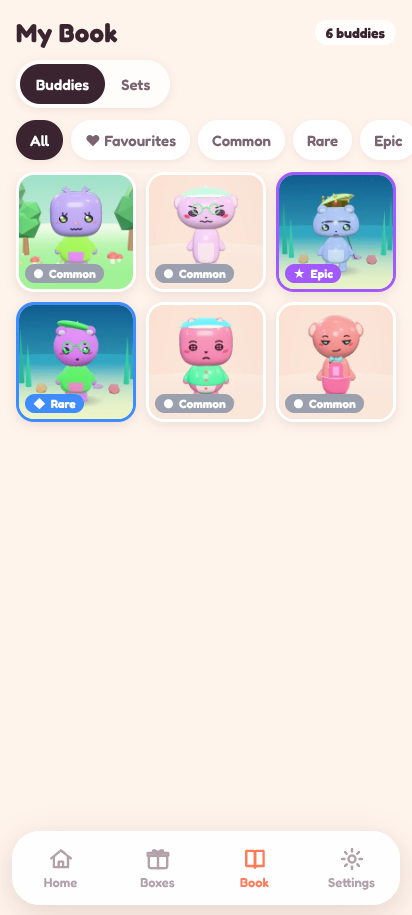

# SpinBuddies

A collectible **blind-box toy app** for Android. Chunky, glossy 3D vinyl buddies whose faces
spin like a real face-changing toy. Open blind boxes, fill your collection book, complete
sets, take on order challenges and swap buddies with friends.

- Every buddy is generated from a short **seed code** (like `K7Q2-MX9A`) — the same code
  makes the same buddy on every phone.
- Swipe the face up/down (or shake the phone) to spin it. Haptic ticks while it spins.
- Rarities: Common, Rare, Epic, Legendary and the very rare **Secret** (0.2%).
- No ads, no real-money purchases, no tracking. All art and sounds are original and made
  in code.

  

More screenshots: [`docs/screens/`](docs/screens/).

## Install the app on an Android phone

1. Open the repository's **Releases** page on GitHub (or **Actions → latest run →
   Artifacts → `SpinBuddies-apk`** for the newest build).
2. Download `SpinBuddies.apk` (or `SpinBuddies-debug.apk`) on the phone.
3. Open it. Android asks to allow installing apps from your browser/files app — allow it
   once, then tap **Install**.
4. Updates install over the old version as long as they are signed with the same key (see
   *Signing* below). Your buddies stay on the phone; use **Settings → Export save file**
   for a backup.

## Develop

Requirements: Node 22+.

```bash
npm ci
npm run dev          # http://localhost:5173 — open with a phone-sized window
npm test             # unit tests (Vitest)
npm run lint
npm run build        # type-check + production build into dist/
npx vite preview     # serve dist/ on :4173
npm run smoke        # Playwright smoke test (after build)
node scripts/screens.mjs   # screenshots into docs/screens (needs preview running)
node scripts/perf.mjs      # 200 re-rolls leak check + triangle budget (needs preview)
```

Dev pages (with `vite preview` running):

- `/?dev=sheet&n=24` — contact sheet of random buddies
- `/?dev=parts&layer=hat` — every part of a layer (hat, ears, outfit, accessory, scene, eyes…)
- `/?dev=leak&n=200` — memory/triangle check

In the app, tap the version number in **Settings** 7 times for the developer menu
(+10 boxes and other helpers).

### Where things live

| Path | What |
|---|---|
| `src/config.ts` | App name, IDs, feature flags, tunables |
| `src/rng.ts` | Seeded PRNG + seed codes |
| `src/gen/` | Parts data (`parts.ts`), palettes, rules, rarity, `generateCharacter` |
| `src/render/` | Three.js: stage, materials, character builder, face decals, scenes, box |
| `src/ui/` | Screens, tab bar, widgets |
| `src/game/` | Collection, series pools, sets, economy, daily, orders, achievements, gifts |
| `src/save/` | Save schema, migrations, export/import |
| `src/audio/` | WebAudio-synthesised sounds and music |
| `tests/` | Unit tests |
| `store/`, `docs/privacy.md` | Play Store listing and privacy policy |

**Adding a part:** add a line to `src/gen/parts.ts` with a **new** `since` version (never
change existing parts — it would change old seeds), then add its renderer in
`src/render/parts/*.ts` (or `face.ts` / `scenes.ts`). `tests/render-coverage.test.ts`
fails until every part has a renderer.

## How builds and releases work

`.github/workflows/android.yml` runs on every push (all branches), on `v*` tags and
manually:

1. `npm ci` → `npm test` → `npm run lint` → `npm run build`
2. JDK 21 + Android SDK → `npx cap sync android`
3. With signing secrets: `assembleRelease bundleRelease` (signed APK + AAB).
   Without: `assembleDebug` (the job summary says so).
4. Artifacts: `SpinBuddies-apk` (and `SpinBuddies-aab`).
5. On a `v*` tag, a GitHub Release is created with the APK attached.

`versionCode` = the GitHub run number; `versionName` = `version` in `package.json`.

To release: bump `version` in `package.json`, commit, then `git tag v0.2.0 && git push --tags`.

### Signing

Android only installs an update over an existing app if both are signed with the same key.
Add these repository secrets (Settings → Secrets and variables → Actions):
`ANDROID_KEYSTORE_BASE64`, `ANDROID_KEYSTORE_PASSWORD`, `ANDROID_KEY_ALIAS`,
`ANDROID_KEY_PASSWORD`. **Keep the keystore and passwords in a password manager — if they
are lost, updates can never be installed over the old app or published to the Play Store.**

> The cloud development sessions cannot run Gradle (Google's Maven is blocked there), so
> APKs are only built by GitHub Actions.

## Licence

MIT — see `LICENSE`. Third-party libraries and the font are listed in `CREDITS.md`.
